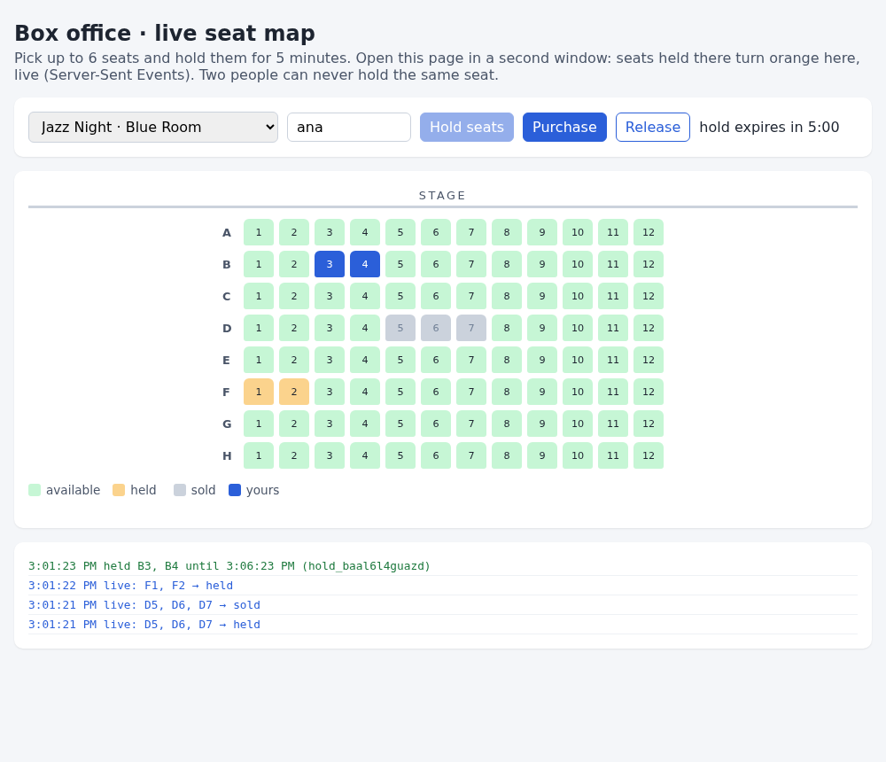
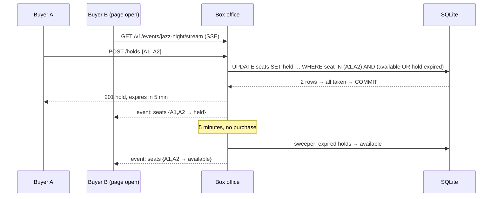

# Go Ticketing API · No Seat Sold Twice

[](https://github.com/edybackend/go-ticketing-api/actions/workflows/ci.yml)
[Leia em português](README.pt-BR.md)

A box office for live events, in **Go**, for the moment tickets go on sale and everybody clicks the same seats:
- **holds** of up to 6 seats, all or nothing, that **expire by themselves** after 5 minutes;
- **idempotent purchases**;
- a **live seat map**: seats taken by others change color as it happens (Server-Sent Events).

200 buyers for one seat: exactly one wins. One binary, embedded page, SQLite.

Small on purpose: it can be read in about 15 minutes and started with one command.



## Quick start

Requirements: Docker.

```bash
docker compose up --build
```

Open http://localhost:8080 **in two windows**. Pick seats in one and hold them: they turn orange in the other at once.
Buy them and they turn grey. Wait 5 minutes without buying and they come back on sale by themselves.

```bash
curl -s -X POST localhost:8080/v1/events/jazz-night/holds -H 'content-type: application/json' \
  -d '{"seats":["A1","A2"],"customer":"ana"}'                      # 201 + hold id, expires in 5 min
curl -s -X POST localhost:8080/v1/events/jazz-night/holds -H 'content-type: application/json' \
  -d '{"seats":["A2","A3"],"customer":"bruno"}'                    # 409 {"seats":["A2"]}: nothing held, A3 stays free
curl -N localhost:8080/v1/events/jazz-night/stream                 # the live feed the page uses
```

<details>
<summary>Without Docker (Go 1.27)</summary>

```bash
go run ./cmd/tickets        # http://localhost:8080 · HOLD_TTL=30s to watch holds expire quickly
```
</details>

## How it works



- **One conditional `UPDATE` is the whole concurrency control.** It takes the requested seats only where they are free (or held by an expired hold). If fewer rows changed than seats were asked for, the transaction rolls back and the response lists the seats that blocked it. There is no "check, then write" window for two buyers to slip through.
- **Expiry needs no timer to be correct.** A hold past its time stops blocking at once, because every read and every new hold treat it as free. The sweeper (every 5 s) only tidies up and tells the live pages.
- **Purchase is idempotent.** `orders.hold_id` is unique, so a retried purchase returns the same order (`200` instead of `201`). An expired hold answers `410 Gone`.
- **The live feed never slows anyone down.** Each subscriber has a buffer of 32 changes. A subscriber that falls behind is dropped; the page reconnects and reloads the map. Publishing never blocks a booking.
- **Graceful shutdown with open streams.** Requests inherit the shutdown context, so open SSE connections end immediately: measured 9 ms to exit with a stream open.

## API

| Method | Route | What it does |
|---|---|---|
| `GET` | `/v1/events` | shows |
| `GET` | `/v1/events/{id}/seats` | seat map: `available`, `held`, `sold` |
| `POST` | `/v1/events/{id}/holds` | `{seats, customer}` → `201` hold · `409` with the blocking seats · `400` · `404` |
| `POST` | `/v1/holds/{id}/purchase` | `201` order · `200` same order again · `410` expired · `409` released |
| `DELETE` | `/v1/holds/{id}` | release the seats (`409` if already purchased) |
| `GET` | `/v1/events/{id}/stream` | Server-Sent Events: `event: seats` with `{seats, status}` |

Errors are RFC 9457 problem details.

## How it is tested

| Behavior | Test |
|---|---|
| 200 goroutines, one seat → 1 hold, 199 conflicts | `TestTwoHundredBuyersOneSeatOneWinner` (`-race`) |
| `A1,A2` vs `A2,A3` → the loser holds nothing | `TestOverlappingHoldsAreAllOrNothing` |
| An expired hold frees its seats before any sweeper; buying it → expired | `TestAnExpiredHoldFreesItsSeatsEvenBeforeTheSweeper` |
| Purchasing twice → the same order | `TestPurchasingTwiceReturnsTheSameOrder`, `TestPurchaseIsIdempotentAndAnExpiredHoldIsGone` |
| A hold by one client reaches another client's stream; leaving removes the subscription | `TestAHoldByOneClientReachesAnotherClientsStream` |
| A subscriber that never reads is dropped; publishing never blocks | `TestASlowSubscriberIsDroppedAndNeverBlocksThePublisher` |
| The real container: 50 concurrent buyers → one `201`, 49 `409`, and the change on the stream | CI job `container` |

A mutation proves the concurrency test is real: without the condition in the `UPDATE`, all 200 buyers "win".

## Tech stack

| Area | Choice |
|---|---|
| Language | Go 1.27, standard library `net/http` (method routing, SSE with `http.Flusher`), `log/slog`, `errgroup` |
| Storage | SQLite via `modernc.org/sqlite` (pure Go, no CGO) |
| Front-end | one HTML file with plain JavaScript (`EventSource`), embedded with `go:embed` |
| Quality | table-driven tests, `-race`, golangci-lint, gofmt |
| Delivery | distroless non-root image, Docker Compose, GitHub Actions |

## Design decisions

- **Compare-and-set in the database, not a lock in memory.** It stays correct with several instances on the same database and survives restarts.
- **Expiry is a read rule, not a job.** If the sweeper stops, no seat stays stuck; it only delays the live notification.
- **SSE, not WebSockets.** The feed is one-way. SSE is plain HTTP with automatic reconnection in the browser, and needs no library on either side.
- **Drop slow subscribers.** A page that cannot keep up reloads the map; the alternative is unbounded memory or a booking path that waits for a browser.
- **The hold is the idempotency key of the purchase.** No extra header is needed: the hold id already identifies the intent.

## Known trade-offs

- **One instance for the live feed.** The broker is in memory; several instances would publish changes through Redis or NATS. Bookings themselves are already safe across instances, because the database decides.
- **No payment step.** A purchase is immediate. A real checkout would hold the seats during payment (see [payments-idempotency](https://github.com/edybackend/payments-idempotency)) and buy on success.
- **No waiting room or per-customer limits.** A big on-sale would queue buyers and cap seats per account.
- **SQLite serializes writes.** That is fine for one venue; a ticketing platform would partition by event on a server database.

## AI-Assisted Engineering

This project was built with Claude Code under explicit engineering controls:

- **Project rules** ([`CLAUDE.md`](CLAUDE.md)) define the box office rules the agent must follow.
- **Hooks** ([`.claude/settings.json`](.claude/settings.json)):
  - run `gofmt` on every change and block edits to data and `go.sum`;
  - **refuse any `UPDATE` that holds seats without the "available" condition** (the compare-and-set);
  - refuse root contexts, `time.Sleep` and huge channel buffers in `internal/`;
  - run vet and race tests before a task is considered done.
- **Spec-first**: each feature starts as a spec in [`specs/`](specs) with acceptance criteria.
- **Same quality gates for every line**: CI runs gofmt, vet, race tests (×3), golangci-lint, 50 concurrent buyers against the container, and secret scanning.

I own the architecture and review every change.

## License

[MIT](LICENSE)
