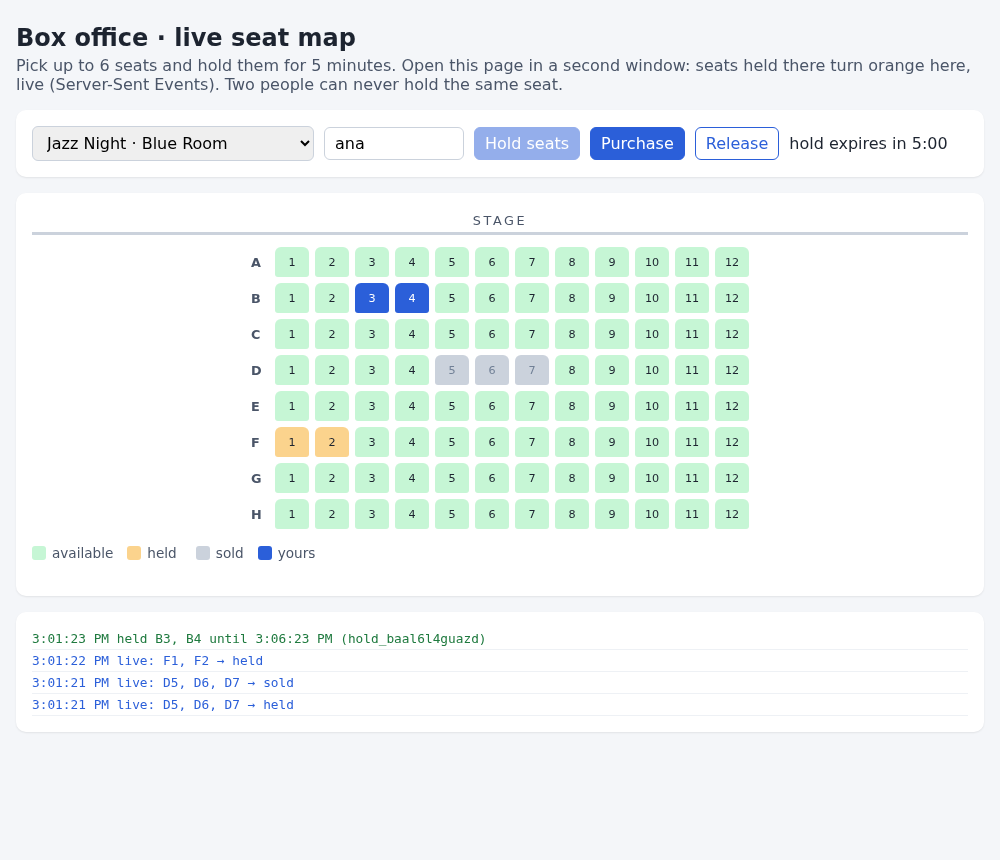
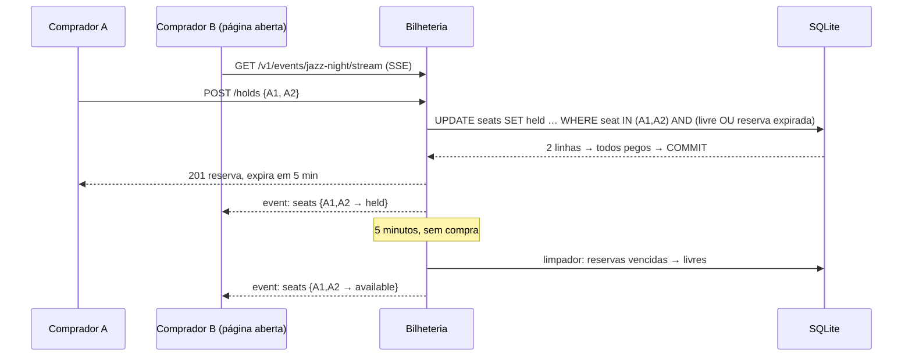

# Go Ticketing API · Nenhum assento vendido duas vezes

[](https://github.com/edybackend/go-ticketing-api/actions/workflows/ci.yml)
[Read in English](README.md)

Uma bilheteria para eventos ao vivo, em **Go**, para o momento em que os ingressos abrem e todo mundo clica nos mesmos
assentos:
- **reservas** de até 6 assentos, tudo ou nada, que **expiram sozinhas** em 5 minutos;
- **compra idempotente**;
- um **mapa de assentos ao vivo**: os assentos que outras pessoas pegam mudam de cor na hora (Server-Sent Events).

200 compradores para um assento: exatamente um vence. Um binário, página embutida, SQLite.

Pequeno de propósito: dá para ler em uns 15 minutos e subir com um comando.



## Como rodar

Requisito: Docker.

```bash
docker compose up --build
```

Abra http://localhost:8080 **em duas janelas**. Escolha assentos numa e reserve: eles ficam laranja na outra na hora.
Compre e eles ficam cinza. Espere 5 minutos sem comprar e eles voltam à venda sozinhos.

```bash
curl -s -X POST localhost:8080/v1/events/jazz-night/holds -H 'content-type: application/json' \
  -d '{"seats":["A1","A2"],"customer":"ana"}'                      # 201 + id da reserva, expira em 5 min
curl -s -X POST localhost:8080/v1/events/jazz-night/holds -H 'content-type: application/json' \
  -d '{"seats":["A2","A3"],"customer":"bruno"}'                    # 409 {"seats":["A2"]}: nada reservado, A3 continua livre
curl -N localhost:8080/v1/events/jazz-night/stream                 # o feed ao vivo que a página usa
```

<details>
<summary>Sem Docker (Go 1.27)</summary>

```bash
go run ./cmd/tickets        # http://localhost:8080 · HOLD_TTL=30s para ver as reservas expirarem rápido
```
</details>

## Como funciona



- **Um único `UPDATE` condicional é todo o controle de concorrência.** Ele pega os assentos pedidos só onde estão livres (ou presos por uma reserva vencida). Se mudaram menos linhas do que assentos pedidos, a transação é desfeita e a resposta lista os assentos que impediram. Não existe janela de "confere e depois grava" para dois compradores passarem ao mesmo tempo.
- **A expiração não depende de timer para estar correta.** Uma reserva vencida para de bloquear na hora, porque toda leitura e toda reserva nova a tratam como livre. O limpador (a cada 5 s) só arruma a casa e avisa as páginas ao vivo.
- **A compra é idempotente.** `orders.hold_id` é único, então uma compra repetida devolve o mesmo pedido (`200` em vez de `201`). Reserva vencida responde `410 Gone`.
- **O feed ao vivo nunca atrasa ninguém.** Cada assinante tem um buffer de 32 mudanças. Quem fica para trás é desconectado; a página reconecta e recarrega o mapa. Publicar nunca bloqueia uma reserva.
- **Desligamento gracioso com streams abertos.** As requisições herdam o contexto de desligamento, então conexões SSE abertas terminam na hora: medi 9 ms para sair com um stream aberto.

## API

| Método | Rota | O que faz |
|---|---|---|
| `GET` | `/v1/events` | shows |
| `GET` | `/v1/events/{id}/seats` | mapa: `available`, `held`, `sold` |
| `POST` | `/v1/events/{id}/holds` | `{seats, customer}` → `201` reserva · `409` com os assentos que impediram · `400` · `404` |
| `POST` | `/v1/holds/{id}/purchase` | `201` pedido · `200` o mesmo pedido de novo · `410` vencida · `409` liberada |
| `DELETE` | `/v1/holds/{id}` | libera os assentos (`409` se já foi comprada) |
| `GET` | `/v1/events/{id}/stream` | Server-Sent Events: `event: seats` com `{seats, status}` |

Erros seguem o RFC 9457 (problem details).

## Como é testado

| Comportamento | Teste |
|---|---|
| 200 goroutines, um assento → 1 reserva, 199 conflitos | `TestTwoHundredBuyersOneSeatOneWinner` (`-race`) |
| `A1,A2` × `A2,A3` → quem perde não fica com nada | `TestOverlappingHoldsAreAllOrNothing` |
| Reserva vencida libera os assentos antes de qualquer limpador; comprá-la → vencida | `TestAnExpiredHoldFreesItsSeatsEvenBeforeTheSweeper` |
| Comprar duas vezes → o mesmo pedido | `TestPurchasingTwiceReturnsTheSameOrder`, `TestPurchaseIsIdempotentAndAnExpiredHoldIsGone` |
| A reserva de um cliente chega ao stream de outro; sair remove a assinatura | `TestAHoldByOneClientReachesAnotherClientsStream` |
| Um assinante que nunca lê é desconectado; publicar nunca bloqueia | `TestASlowSubscriberIsDroppedAndNeverBlocksThePublisher` |
| O contêiner real: 50 compradores simultâneos → um `201`, 49 `409`, e a mudança no stream | job `container` do CI |

Uma mutação prova que o teste de concorrência é real: sem a condição no `UPDATE`, os 200 compradores "vencem".

## Tecnologias

| Área | Escolha |
|---|---|
| Linguagem | Go 1.27, `net/http` da biblioteca padrão (rotas por método, SSE com `http.Flusher`), `log/slog`, `errgroup` |
| Armazenamento | SQLite via `modernc.org/sqlite` (Go puro, sem CGO) |
| Front-end | um arquivo HTML com JavaScript puro (`EventSource`), embutido com `go:embed` |
| Qualidade | testes em tabela, `-race`, golangci-lint, gofmt |
| Entrega | imagem distroless sem root, Docker Compose, GitHub Actions |

## Decisões de design

- **Compare-and-set no banco, não lock em memória.** Continua correto com várias instâncias no mesmo banco e sobrevive a reinícios.
- **Expiração é regra de leitura, não um job.** Se o limpador parar, nenhum assento fica preso; só atrasa o aviso ao vivo.
- **SSE, não WebSocket.** O feed é de mão única. SSE é HTTP comum, com reconexão automática no navegador, e não precisa de biblioteca em nenhum dos lados.
- **Desconectar assinante lento.** Uma página que não acompanha recarrega o mapa; a alternativa seria memória sem limite ou uma reserva esperando um navegador.
- **A reserva é a chave de idempotência da compra.** Não precisa de cabeçalho extra: o id da reserva já identifica a intenção.

## Trade-offs conhecidos

- **Uma instância para o feed ao vivo.** O broker é em memória; várias instâncias publicariam as mudanças via Redis ou NATS. As reservas já são seguras entre instâncias, porque quem decide é o banco.
- **Sem etapa de pagamento.** A compra é imediata. Um checkout real seguraria os assentos durante o pagamento (veja [payments-idempotency](https://github.com/edybackend/payments-idempotency)) e compraria no sucesso.
- **Sem sala de espera nem limite por cliente.** Uma grande abertura de vendas colocaria os compradores em fila e limitaria assentos por conta.
- **O SQLite serializa as escritas.** Basta para um local de show; uma plataforma de ingressos particionaria por evento num banco servidor.

## Engenharia assistida por IA

Este projeto foi construído com o Claude Code sob controles explícitos de engenharia:

- **Regras do projeto** ([`CLAUDE.md`](CLAUDE.md)) definem as regras da bilheteria que o agente segue.
- **Hooks** ([`.claude/settings.json`](.claude/settings.json)):
  - rodam `gofmt` em cada mudança e bloqueiam edição de dados e do `go.sum`;
  - **recusam qualquer `UPDATE` que reserve assentos sem a condição "available"** (o compare-and-set);
  - recusam contexto raiz, `time.Sleep` e buffers gigantes em `internal/`;
  - rodam vet e testes com race antes de a tarefa ser dada como pronta.
- **Spec primeiro**: cada funcionalidade começa como especificação em [`specs/`](specs), com critérios de aceite.
- **Os mesmos portões de qualidade para cada linha**: o CI roda gofmt, vet, testes com race (×3), golangci-lint, 50 compradores simultâneos contra o contêiner e varredura de segredos.

A arquitetura é minha, e eu reviso cada mudança.

## Licença

[MIT](LICENSE)
